# @tfm/core: Motor de Orquestación Agéntica y Algoritmos Deterministas

El paquete `@tfm/core` constituye el núcleo computacional y metodológico del Trabajo de Fin de Máster. Implementa una máquina de estados conversacional y jerárquica basada en **LangGraph**, integrada con un catálogo de algoritmos deterministas multiterio (**AHP**, **SIPAC**, **ALTUS**) y una capa agnóstica de abstracción para Modelos de Lenguaje Grande (**LLMs**).

---

## 🏛️ Arquitectura General

<p align="center">
  
</p>

*Figura: Diagrama de la máquina de estados conversacional y jerárquica de LangGraph implementada en el motor agéntico.*

---

## 🔄 Máquina de Estados y Patrón Doble Cola

El grafo opera sobre un estado tipado (`GraphAnnotation`) que gestiona el ciclo de vida del preproyecto mediante el **patrón de Doble Cola**:

1. **`taskQueue` (Cola de Tareas):** Macro-etapas del preproyecto (análisis de objetivos, definición de procesos, evaluación de viabilidad, selección de agentes).
2. **`actionsQueue` (Cola de Acciones):** Micro-pasos secuenciales dentro de cada tarea (extracción de requerimientos, resolución de dudas con el usuario, ejecución de algoritmos deterministas).

### Nodos Principales
* **`taskLoader`:** Extrae la siguiente tarea pendiente de la cola. Si la cola está vacía, finaliza la ejecución (`END`).
* **`extractAction`:** Desencadena la acción actual y determina si requiere interacción humana o procesamiento interno.
* **`questionManager`:** Formula preguntas al usuario y clasifica la respuesta recibida (respuesta concluyente, duda del usuario, o necesidad de confirmación).
* **`doubtConfirmer`:** Disuelve malentendidos o confirma ambigüedades técnicas antes de invocar conocimiento experto.
* **`knowledgeConsultant`:** Asistente especializado en SWEBOK v4 y DTGEP que aclara dudas contextuales del usuario sin alterar el flujo principal.
* **`contextProcessor`:** Normaliza y almacena la información provista en el mapa de contexto (`contextMap`).
* **`architect`:** Valida la suficiencia técnica de las respuestas provistas y decide si es necesario formular preguntas de seguimiento (*follow-ups*).
* **`executeInternalAction`:** Ejecuta algoritmos analíticos deterministas (AHP, SIPAC, ALTUS) de manera local sin llamadas redundantes a LLM.
* **`actionAnswerSummarizer`:** Sintetiza el resultado de la acción completada.
* **`executeActionHook` & `executeTaskHook`:** Disparan eventos personalizables (actualización de bases de datos, webhooks, trazas Phoenix).
* **`saveToOutput`:** Persiste el resultado en el documento de salida de la sesión (`outputJson`).
* **`taskSummarizer`:** Genera un resumen ejecutivo del hito completado antes de avanzar a la siguiente tarea.

### Persistencia y Checkpointing
Al compilar el grafo con la variable `TFM_WEB="true"`, se acopla un checkpointer de memoria persistente ([`MemorySaver`](file:///Users/adrian/Documents/Universidad/TFM/core/src/graph.ts#L164-L166)). Esto permite pausar la ejecución del grafo en cualquier nodo interactivo (`questionManager`), enviar eventos SSE a la interfaz web, y reanudar la ejecución cuando el usuario responde.

---

## 🧮 Algoritmos Deterministas de Decisión

Para garantizar rigor científico y eliminar la alucinación en la toma de decisiones, `@tfm/core` aísla las evaluaciones numéricas en tres módulos algorítmicos deterministas:

### 1. AHP (Analytic Hierarchy Process) — [`src/ahp_logic.ts`](file:///Users/adrian/Documents/Universidad/TFM/core/src/ahp_logic.ts)
Implementa el Proceso Analítico Jerárquico de Thomas Saaty para priorización multicriterio de agentes o alternativas de software:
* **Matriz de Comparación por Pares ($A$):** Matriz recíproca $n \times n$ donde $a_{ji} = \frac{1}{a_{ij}}$.
* **Vector de Pesos Propios ($w$):** Obtenido mediante aproximación de vector propio normalizado (media geométrica por filas).
* **Máximo Autovalor ($\lambda_{\max}$):** Calculado como $\lambda_{\max} = \frac{1}{n} \sum_{i=1}^{n} \frac{(A w)_i}{w_i}$.
* **Índice de Consistencia ($CI$):**
  $$CI = \frac{\lambda_{\max} - n}{n - 1}$$
* **Ratio de Consistencia ($CR$):**
  $$CR = \frac{CI}{RI(n)}$$
  donde $RI(n)$ es el índice aleatorio empírico de Saaty. La función valida deterministamente que $CR < 0.10$ para certificar una ponderación libre de contradicciones lógicas.

### 2. SIPAC (Software Idea Prioritization by Adaptive Criteria) — [`src/sipac_logic.ts`](file:///Users/adrian/Documents/Universidad/TFM/core/src/sipac_logic.ts)
Modela la viabilidad y valor estratégico de procesos y artefactos:
* **Normalización de Indicadores:**
  * Sentido directo (mayor es mejor): $S = \frac{\text{actual} - \min}{\max - \min}$
  * Sentido inverso (menor es mejor): $S = \frac{\max - \text{actual}}{\max - \min}$
* **Cálculo del Gap Relativo ($U_{gap}$):**
  $$U_{gap} = \min(0, S_{\text{actual}} - T_{\text{meta}})$$
* **Coordenadas de la Matriz 2×2:**
  * $V_{\text{calidad}}$: Agregación de indicadores de calidad técnica y madurez.
  * $W_{\text{impacto}}$: Agregación de retorno estratégico y repercusión en negocio.
  * Clasificación cuadrangular automática: `stable`, `evolving`, `replaceable`, `warning`.
  * $X_{\text{final}}$: Índice unificado de necesidad y prioridad de intervención.

### 3. ALTUS (Maturity & Architectural Evaluation) — [`src/altus_logic.ts`](file:///Users/adrian/Documents/Universidad/TFM/core/src/altus_logic.ts)
Evalúa las capacidades y madurez del sistema organizacional frente a agentes generativos:
* **7 Dimensiones Arquitectónicas:**
  1. `CONF` (Configuración)
  2. `FORM` (Formación / Capacitación)
  3. `OPER` (Operacional)
  4. `PRO` (Proactividad)
  5. `VAL` (Valoración SP3)
  6. `SOCI` (Social e Interacción Humano-Agente)
  7. `MEMO` (Memoria Transactiva)
* **4 Niveles de Madurez (ML1 a ML4):** Escala de 255 puntos totales con categorización Likert (`BAD`: 0-1, `MID`: 2-3, `GOOD`: 4-5) y distribución Balanced ScoreCard.

---

## 📋 Especificación y Creación de Metodologías (JSON Schema)

El motor `@tfm/core` opera de forma completamente declarativa. Cualquier metodología de preproyecto (como las implementaciones oficiales de **ALTUS**, **SIPAC** y **AHP**) se define mediante un archivo de configuración JSON estructurado que parametriza:

* **Políticas de Ejecución (`profile`):** Activación de repreguntas adaptativas del arquitecto (`allowFollowUps`), resolución de dudas técnicas con la base de conocimiento (`allowKnowledgeConsultation`), resúmenes de hito (`generateTaskSummaries`) y ganchos evaluadores (`hooks.afterActionAnswer`).
* **Macro-Etapas (`tasks`):** Colección jerárquica de objetivos de preproyecto con metadatos asociados.
* **Micro-Operaciones (`actions`):**
  * `question`: Preguntas interactivas formuladas al usuario en el chat.
  * `internal`: Deducciones y razonamientos internos ejecutados por el LLM sin interrumpir al usuario, con validación estricta vía `outputSchema` (JSON Schema).
  * `loop_validation`: Bucles que desenrollan dinámicamente colecciones descubiertas en tiempo de ejecución.
* **Interpolación Dinámica de Variables:** Compartición reactiva de estado (`{mi_variable}`) entre acciones sucesivas.

> [!TIP]
> Para conocer la especificación exhaustiva de cada campo, la semántica de los bucles y ver ejemplos funcionales paso a paso, consulta la [**Guía Completa de Configuración de Metodologías (`METHODOLOGY_GUIDE.md`)**](METHODOLOGY_GUIDE.md).

---

## 🤖 Capa de Abstracción LLM (`src/llm/`)

Diseñada para operar en entornos híbridos y desacoplada de proveedores específicos:

```
src/llm/
├── client.ts              # Factoría agnóstica (Ollama, Google GenAI, OpenAI/LiteLLM)
├── schemas.ts             # Esquemas Zod estrictos para extracción y estructuración
├── structuredOutput.ts    # Extracción con validación de tipo y auto-reparación JSON
├── operations.ts          # Operaciones atómicas de análisis, clasificación y síntesis
└── index.ts               # Punto de entrada unificado
```

* **Validación Zod Estricta:** Las respuestas del LLM son forzadas a cumplir esquemas TypeScript tipados en tiempo de compilación.
* **Modo Local Offline:** Soporta inferencia local mediante Ollama (`deepseek-r1:7b`, `qwen2.5:7b`, etc.) sin enviar datos fuera de la red local.

---

## 📊 Suite de Evaluación (`eval/`)

Permite ejecutar benchmarks científicos rigurosos y comparar familias de modelos:

| Script | Descripción |
| :--- | :--- |
| `eval/runner.ts` | Ejecuta la batería de pruebas sobre tareas predefinidas. |
| `eval/runner.ts --models=...` | Evaluación matricial comparativa entre modelos locales y en la nube. |
| `eval/calibrate_threshold.ts` | Calibración empírica de umbrales de incertidumbre y confianza. |
| `eval/recalculate.ts` | Re-evaluación offline usando la caché de respuestas guardadas. |
| `eval/run_baseline.ts` | Ejecución de la línea base (baseline) sin asistencia agéntica. |

---

## 🧪 Pruebas Automatizadas

El proyecto cuenta con 80 tests unitarios y funcionales ejecutados con Vitest:

```bash
# Ejecutar suite de pruebas unitarias
bun test
# o con npm:
npm test

# Ejecutar pruebas con LLM activo (requiere OLLAMA_BASE_URL o API Key)
bun run test:llm
```
